# Market Surveillance Engine for Electronic Trading

A desktop market-surveillance and trading-analytics terminal built entirely with
**Java Swing**. Ten modules in one application, all driven by a single simulated
market engine.

> **Note on running this project:** this is a Java **desktop** application. It
> cannot run in a browser, so GitHub Pages will not work for it. Clone the
> repository and run it with `./run-demo.sh` — see [Running it](#running-it).

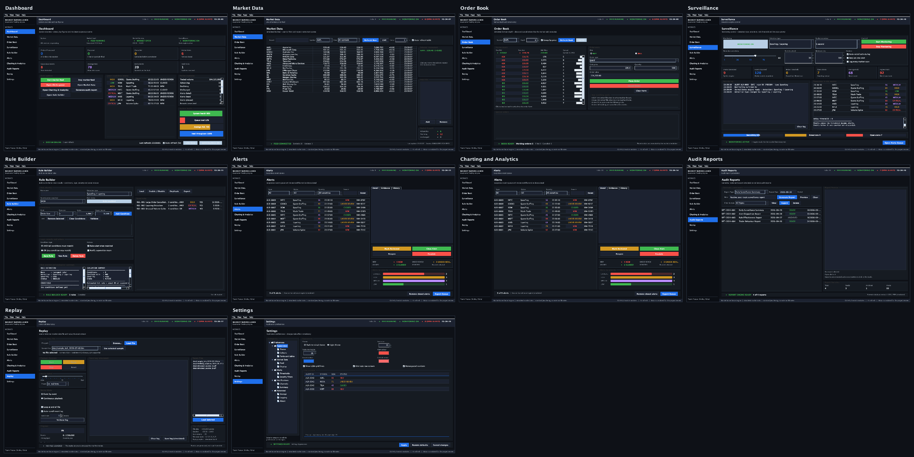

---

## The ten modules

| # | Module | What it does |
|---|--------|--------------|
| 1 | **Dashboard** | System status, eight KPI tiles, latest suspicious events, market statistics |
| 2 | **Market Data** | Simulated live feed with search, watchlist and market breadth |
| 3 | **Order Book** | Market depth ladder, order entry, order matching |
| 4 | **Surveillance** | Detection engine control, sensitivity, risk threshold, live scan log |
| 5 | **Rule Builder** | Build surveillance rules visually with conditions and AND/OR logic |
| 6 | **Alerts** | Suspicious-event queue with review workflow and evidence detail |
| 7 | **Charting & Analytics** | Order-flow statistics and custom-painted charts |
| 8 | **Audit Reports** | Generate, view and export audit reports |
| 9 | **Replay** | Historical market-data replay controls |
| 10 | **Settings** | Preferences that change the running engine |

### Screens

| Module | Screenshot |
|---|---|
| Dashboard | 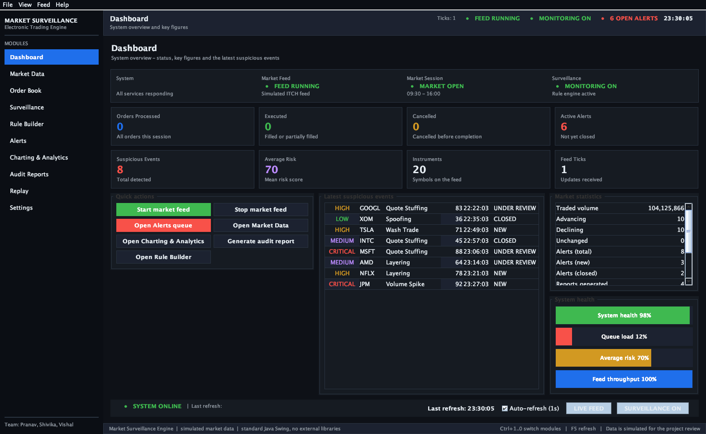 |
| Market Data | 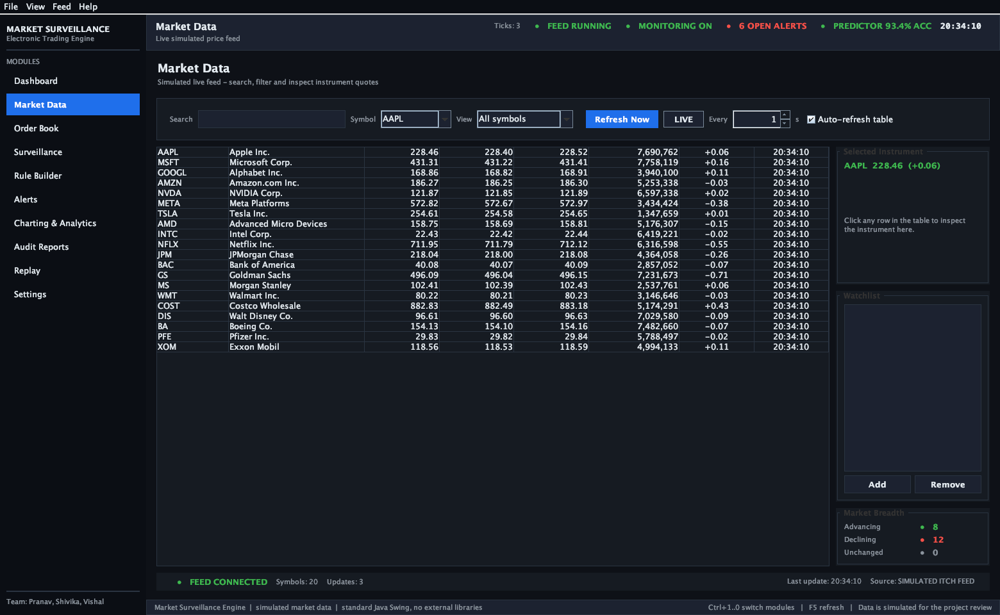 |
| Order Book | 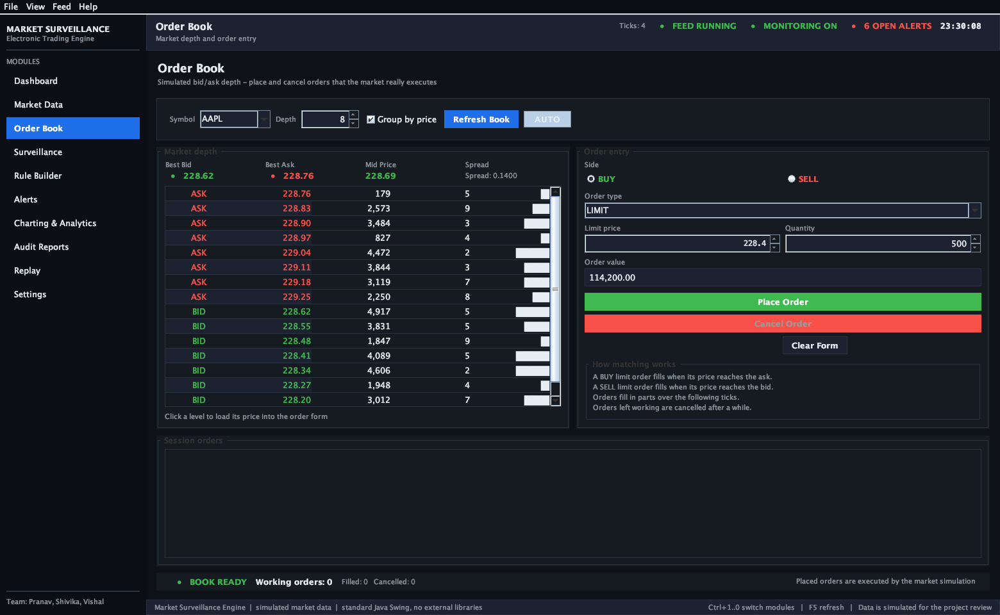 |
| Surveillance | 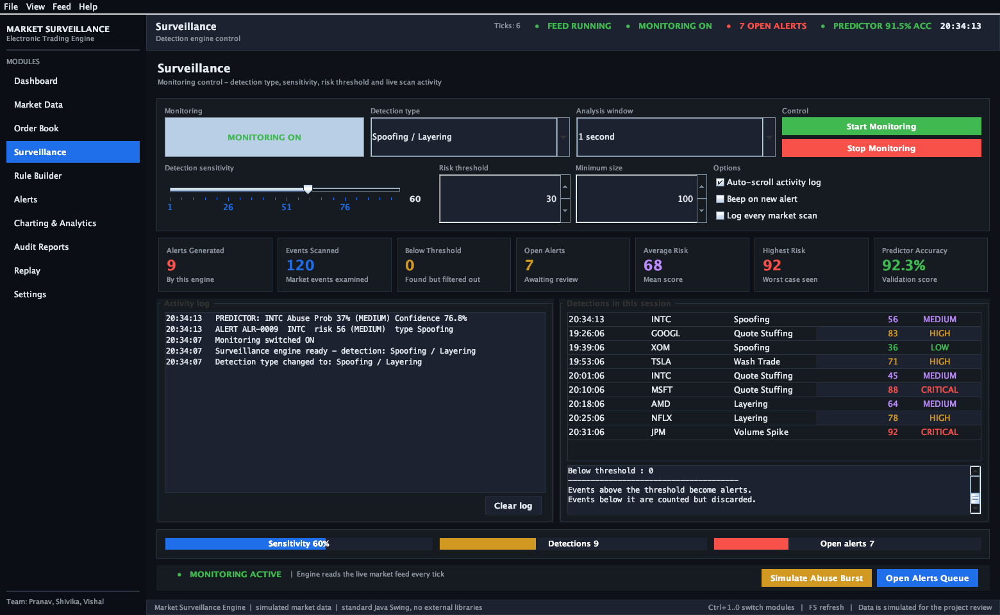 |
| Rule Builder | 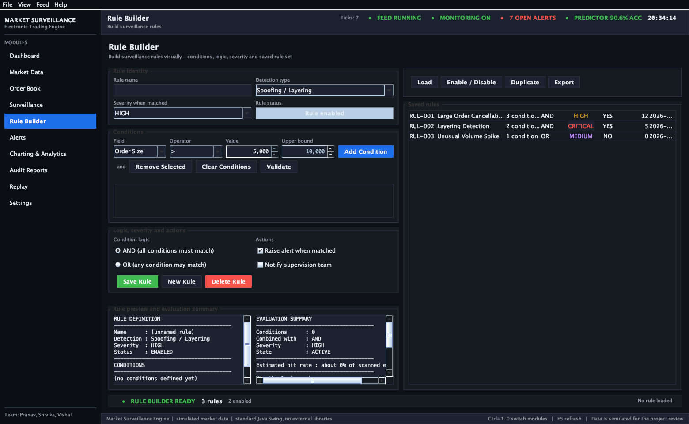 |
| Alerts | 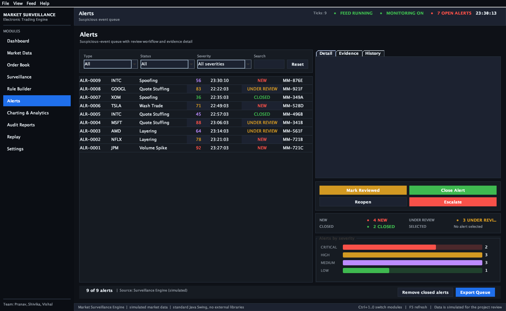 |
| Charting & Analytics | 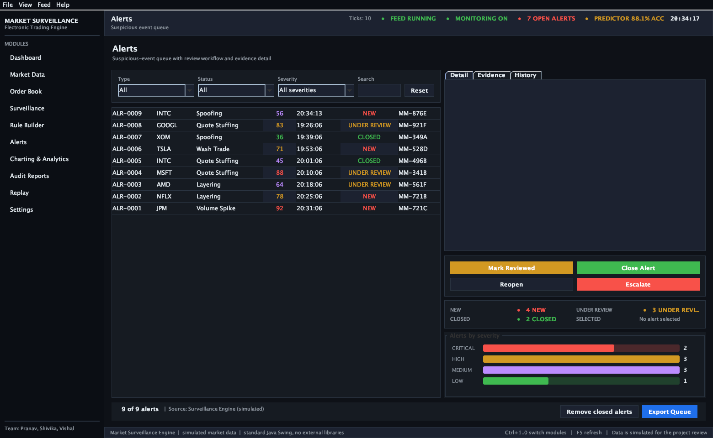 |
| Audit Reports | 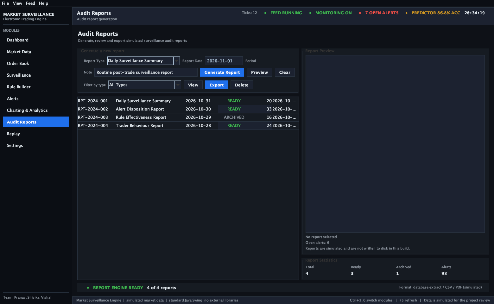 |
| Replay | 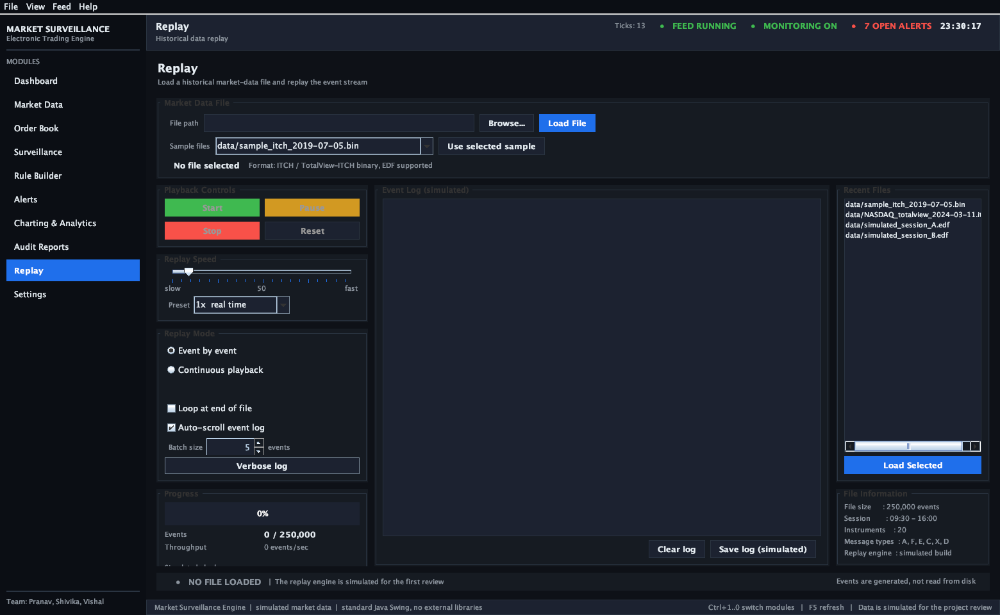 |
| Settings | 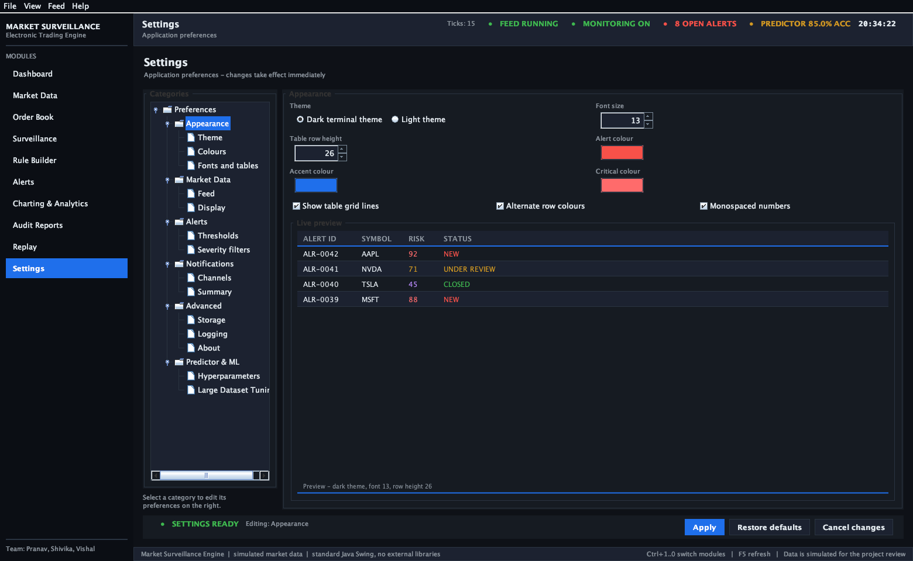 |

---

## Running it

**Requirements:** a Java JDK — version 8 or newer. Nothing else. No database, no
build tool, no external libraries.

**Easiest way - no Terminal needed:** double-click **`START-APP.command`**.
It compiles the project if needed and opens the application window.

**From Terminal:**

```bash
git clone https://github.com/amaikudu/MSSET.git
cd MSSET
./run-demo.sh
```

On Windows, run the same steps with `build.bat`-style commands:

```bat
javac -encoding UTF-8 -d build (dir /s /b src\*.java tools\*.java)
java -cp build Main
```

### Other commands

| Command | What it does |
|---|---|
| `START-APP.command` | Double-click in Finder to compile and start the app |
| `./build.sh` | Compile everything and run the pre-submission check |
| `./run-demo.sh` | Start the application |
| `./run-smoke-test.sh` | Build all ten modules headlessly and fail on any exception |
| `./verify-all.sh` | Build + smoke test + code check |

---

## Architecture

Four layers. Dependencies point **one way only**:

```
gui/        panels - build components, react to events
  |
service/    simulation, surveillance, analytics, reports
  |
model/      plain data classes: fields and getters
  |
util/       shared theme, demo data, formatting
```

**One clock drives everything.** `MarketDataService` owns the only
`javax.swing.Timer` in the application. On every tick it moves prices, matches
waiting orders, then notifies every subscriber through a small `MarketListener`
interface:

```
MarketDataService (one Timer, on the Event Dispatch Thread)
        |
        +--> MarketDataPanel      refreshes the quotes table
        +--> SurveillanceService  may raise an alert
        +--> AnalyticsService     records price history
```

The main frame creates each service **once** and injects it into every panel, so
two screens can never show data that disagrees.

### Why `javax.swing.Timer` and not a thread

Swing is not thread-safe: only the Event Dispatch Thread may touch components.
`Timer` fires on that thread, so every panel updates its labels and tables
directly — no locks, no `SwingUtilities.invokeLater` scattered everywhere, and no
risk of random GUI corruption.

### No external libraries

Standard Java and Swing only. The three charts (price line, volume bars, alert
distribution) are painted by hand with `Graphics2D`.

---

## Project structure

```
src/
  Main.java                    entry point
  gui/                         one file per module, plus MainFrame (the shell)
  model/                       MarketRow, Alert, AuditReport, AnalyticsStats,
                               LiveOrder, SurveillanceRule
  service/                     MarketDataService, SurveillanceService,
                               AnalyticsService, ReportService, DataStore
  util/                        DarkTheme, DemoData, DateTimeUtil, SettingsStore
tools/                         development helpers, not part of the application
shots/                         screenshots used in this README
```

---

## About the data

All market data is **simulated**. There is no exchange connection, no database and
no persistence: the demonstration data is recreated each time the application
starts, so a demo always begins from the same state. The `Replay` module drives a
simulated event stream behind real playback controls.

The `marketData` random generator is seeded with a fixed value, so the sequence of
simulated prices is repeatable between runs.

---

## Verification

```bash
./verify-all.sh
```

```
Files checked : 27
Problems      : 0
RESULT: READY TO SUBMIT
SMOKE TEST PASSED - all 10 modules built and updated without exceptions.
```

The smoke test creates all ten modules, runs the market clock, places and cancels
an order, adds and removes a rule, and fails if anything throws.

---

## Team

Built by Pranav, Shivika and Vishal.

- `VIVA-GUIDE.txt` — file-by-file explanation of the code and the reasoning
- `PRESENTATION-SPLIT.txt` — who presents which module, and what to demonstrate

---

## Publishing to GitHub

```bash
# 1. Stage and commit changes
git add -A
git commit -m "Describe what you changed"

# 2. Push
git push
```

If you have not connected the repository to GitHub yet:

```bash
# Create an EMPTY repository on github.com first - do not add a README,
# .gitignore or licence, because this project already has them.
git remote add origin https://github.com/<your-username>/<your-repo>.git
git branch -M main
git push -u origin main
```

GitHub no longer accepts your account password over HTTPS. When it asks for a
password, paste a **personal access token**:

1. GitHub -> Settings -> Developer settings -> Personal access tokens
2. "Tokens (classic)" -> Generate new token -> tick the `repo` scope
3. Copy the token and paste it as the password

### Why GitHub Pages cannot host this

GitHub Pages serves static files (HTML, CSS, JavaScript) only. This is a Java
desktop application and needs a JVM, so it cannot run in a browser. Use the
screenshots in `shots/` to show what it looks like, and run it locally with
`./run-demo.sh`.
